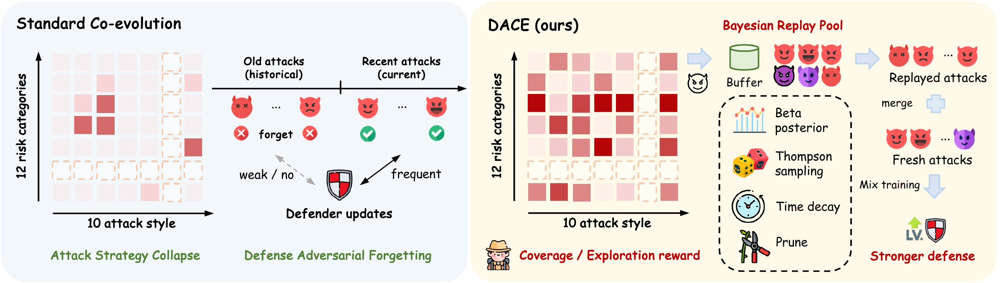
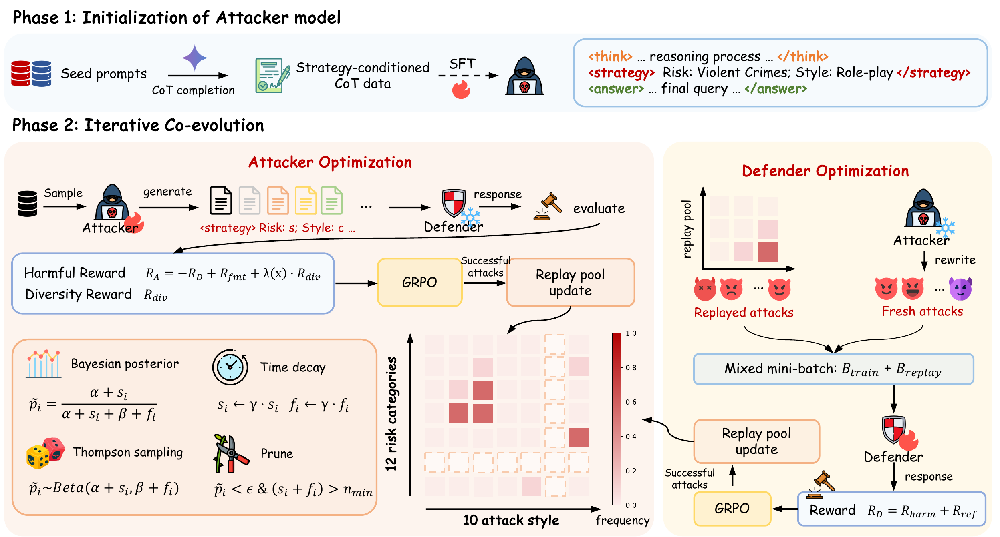

<h1 align="center">DACE: Diversity-Driven Adversarial Co-Evolution for Robust LLM Safety Alignment</h1>

<p align="center">
  <a href="https://neurips.cc/"></a>
  <a href="https://github.com/vllm-project/vllm"></a>
  <a href="https://opensource.org/licenses/Apache-2.0"></a>
</p>

> **Warning:** this repository contains adversarial prompts and data used for LLM safety research. They are provided for evaluation and alignment purposes only and do not endorse the underlying harmful intent.

# 🤗 Overview

<p align="center">
  
</p>

Recent co-evolutionary frameworks let a defender LLM chase a moving attacker LLM, but their training dynamics expose two compounding pathologies:

- **Attack strategy collapse** — the attacker overfits to a narrow set of high-reward rewrites, so the defender only sees a biased slice of the threat landscape;
- **Defense adversarial forgetting** — the defender silently loses competence against earlier attacks as the attack distribution drifts.

**DACE** targets both pathologies jointly:

- **Strategy-level exploration for the attacker.** An explicit two-dimensional attack strategy space (12 risk categories × 10 attack styles) with a **normalized marginal coverage gain** reward, giving a bounded, non-vanishing exploration signal at the strategy layer (not just textual novelty).
- **Bayesian adversarial replay for the defender.** A unified archive of successful attacks whose **Beta–Bernoulli threat posteriors** are refreshed by **time decay**, sampled via **Thompson sampling**, and conservatively **pruned**; replayed attacks are mixed with fresh attacks in every defender batch.
- **Results.** Across standard safety, automated-attacker (OOD red-teaming), and general-capability benchmarks, DACE improves robustness to out-of-distribution attacks while preserving general capabilities, and yields broader attacker strategy coverage.

# 📒 Method

<p align="center">
  
</p>

DACE runs in two phases:

- **Phase 1 — Attacker warm-up (SFT).** The attacker is fine-tuned on strategy-conditioned CoT data so that it emits `<think> … </think><strategy> risk category: …; attack style: … </strategy><answer> rewritten prompt </answer>`.
- **Phase 2 — Iterative co-evolution (GRPO).** Attacker and defender are optimized alternately (attacker-first by default):
  1. *Attacker stage* (defender frozen): R<sub>A</sub> = −R<sub>D</sub> + R<sub>fmt</sub> + λ(x)·R<sub>div</sub>, where R<sub>div</sub> is the normalized marginal coverage gain on the strategy grid and λ(x) depends on whether the attack succeeds; successful attacks are inserted into the archive.
  2. *Defender stage* (attacker frozen): train on a mixed batch D<sub>train</sub> = D<sub>new</sub> ∪ D<sub>replay</sub>, where D<sub>replay</sub> is drawn from the archive by Thompson sampling; the posteriors of replayed attacks are updated from the defender's rollouts.

# 📁 Repository Structure

```
DACE-NeurIPS/
├── data/safety/            # RL seed prompts (WildJailbreak vanilla harmful / benign) + preprocess_dace.py
├── data-sft/               # (optional) strategy-conditioned CoT distillation pipeline for the SFT data
├── prompt/game/            # attacker / defender system prompts
├── scripts/
│   ├── rl/                 # Phase-2 DACE training (train_dace.sh + one wrapper per backbone)
│   └── model_merge.sh      # FSDP checkpoint -> HuggingFace format
├── src/
│   ├── 360-LLaMA-Factory/  # Phase-1 attacker SFT (examples/train_full/*_v4_full_sft_dsz2.yaml)
│   └── verl/               # Phase-2 multi-agent RL (verl.separated_trainer)
└── eval/                   # Table 1 / 2 / 3 evaluation (safety-eval-fork, olmes, OpenRT), see eval/README.md
```

DACE-specific RL components live in `src/verl/verl/separated_trainer/ppo/archive_pool.py` (strategy grid, coverage-gain reward, Bayesian replay pool) and `src/verl/verl/separated_trainer/ppo/ray_trainer.py` (diversity-reward injection, replay batches, stage transitions).

# 🚀 Getting Started

We recommend CUDA 12.4 + PyTorch 2.6 + Python 3.10. Phase 1 (LLaMA-Factory) and Phase 2 (verl) pin different versions of `accelerate` / `datasets` / `peft`, so they use two environments.

```bash
# Phase 2: RL (also used for data preprocessing and SFT data distillation)
conda create -n dace python=3.10.0
conda activate dace
pip install -r requirements.txt
pip install flash-attn==2.7.4.post1 --no-build-isolation
pip install -e src/verl --no-deps

# Phase 1: attacker SFT
conda create -n dace-sft python=3.10.0
conda activate dace-sft
pip install torch==2.6.0 torchvision==0.21.0 torchaudio==2.6.0
pip install flash-attn==2.7.4.post1 --no-build-isolation
pip install -e "src/360-LLaMA-Factory[torch,deepspeed]"
```

- Building `flash-attn` needs a CUDA 12.x toolkit (`nvcc`); alternatively install the matching prebuilt wheel from the [flash-attention releases](https://github.com/Dao-AILab/flash-attention/releases).
- `meta-llama/Llama-3.1-8B-Instruct` (and GPQA in evaluation) are gated on the HF Hub: run `huggingface-cli login` or `export HF_TOKEN=...` first.
- The evaluation environments are described in [eval/README.md](eval/README.md).

# 📦 Data

**RL seeds.** `data/safety/` ships the WildJailbreak vanilla harmful / benign seed pools and 250 benign validation prompts. `preprocess_dace.py` takes the first 15k harmful + 15k benign seeds and builds the parquet files used by training (run it in the `dace` env from the repo root):

```bash
python data/safety/preprocess_dace.py --local_dir data/safety --write_test_parquet
# -> data/safety/train_dace.parquet, data/safety/test_wjb_dace.parquet
```

**SFT data.** Download the distilled strategy-conditioned CoT data from [pursuitYP/DACE_SFT_Data](https://huggingface.co/datasets/pursuitYP/DACE_SFT_Data) and place the two files under `src/360-LLaMA-Factory/data/`:

```bash
huggingface-cli download pursuitYP/DACE_SFT_Data --repo-type dataset --local-dir src/360-LLaMA-Factory/data \
  --include game_cot_dace_v4_harmful.json game_cot_dace_v4_benign.json
```

<details>
<summary>(Optional) Re-distill the SFT data yourself</summary>

The harmful seeds come from the training data of Jailbreak-R1 (`wildteam_with_think-v5.json`, `warmup_attack_target.json`, `train_target_total_5062.json`; put them under `data-sft/`); the benign seeds are the bundled WildJailbreak benign prompts. The CoT rewrites are distilled with Gemini-2.5-Pro (a few harmful prompts that it refused were completed with a newer Gemini model, selectable via `DISTILL_MODEL`) through any OpenAI-compatible endpoint:

```bash
python data-sft/prepare_vanilla_benign_jsonl.py
python data-sft/prepare_vanilla_harmful_jsonl.py
python data-sft/dedup_vanilla_harmful.py

export DISTILL_API_KEY=<YOUR_API_KEY>
export DISTILL_BASE_URL=<OPENAI_COMPATIBLE_BASE_URL>   # optional
export DISTILL_MODEL=gemini-2.5-pro                     # optional
bash data-sft/run_cot_distill_v4.sh                     # idempotent; re-run until all prompts are done

python data-sft/convert_v4_cot_to_game_format.py        # -> src/360-LLaMA-Factory/data/game_cot_dace_v4_*.json
```

Our released data has 20,000 benign and 23,149 harmful examples (5,794 harmful seeds × 4 directed attack styles; a few prompts never yield a valid sample and are dropped by the conversion step).
</details>

# 🛡️ Judge Model

Qwen3Guard is used as the safety judge for the RL reward (and for in-distribution safety evaluation). Serve it with any OpenAI-compatible server; the code expects the served model name `orm`:

```bash
vllm serve Qwen/Qwen3Guard-Gen-8B --served-model-name orm --port <PORT>
export WILDGUARD_API_ENDPOINT=http://<GUARD_HOST>:<PORT>/v1   # Qwen3Guard endpoint (variable name kept for compatibility)

# quick connectivity check
python -m verl.utils.reward_score.game
```

# ✈️ Training

## Phase 1: attacker SFT

```bash
conda activate dace-sft
cd src/360-LLaMA-Factory
llamafactory-cli train examples/train_full/qwen2d5-7b_v4_full_sft_dsz2.yaml
# other backbones: llama3d1-8b_v4_full_sft_dsz2.yaml (Llama-3.1-8B), qwen2d5-14b_v4_full_sft_dsz2.yaml (Qwen2.5-14B)
# output: src/360-LLaMA-Factory/saves/dace_sft/<yaml file name without .yaml>
cd ../..
```

Full-parameter SFT with DeepSpeed ZeRO-2, lr 5e-6, 3 epochs, cosine schedule with warmup ratio 0.1, per-device batch 1 × grad-accum 2 (global batch 16 in our runs), cutoff length 32768, 10% of the data held out for validation.

## Phase 2: DACE co-evolution

```bash
conda activate dace                 # from the repo root
export WILDGUARD_API_ENDPOINT=http://<GUARD_HOST>:<PORT>/v1
export WANDB_API_KEY=<API_KEY>      # optional; W&B logs offline unless WANDB_MODE=online

bash scripts/rl/train_dace_qwen2.5_7b.sh
# bash scripts/rl/train_dace_llama3.1_8b.sh
# bash scripts/rl/train_dace_qwen2.5_14b.sh
```

Each wrapper sets `ATTACKER_MODEL_PATH` (the Phase-1 SFT output), `DEFENDER_MODEL_PATH` (the instruct model) and `EXP_NAME`, then calls `scripts/rl/train_dace.sh`. Checkpoints are written to `checkpoints/Game-separated/<experiment_name>` with `<experiment_name> = <EXP_NAME>-<START_AGENT>1st-<timestamp>` (override the root with `CHECKPOINT_DIR`). Ray starts with `NUM_GPUS` (default 8), split evenly between the attacker and the defender.

Main hyperparameters (defaults of `scripts/rl/train_dace.sh`):

| Group | Setting |
|---|---|
| GRPO | train batch 64 prompts, rollout n = 6, lr 1e-6, no KL loss, 300 steps |
| Lengths | max prompt 8192, max response 6144 tokens (per turn) |
| Agent switching | ratio mode, switch every 15 steps, attacker : defender = 1 : 1, `START_AGENT=attacker` |
| Coverage reward | λ<sub>succ</sub> = 1.0, λ<sub>fail</sub> = 0.5, ε<sub>div</sub> = 1e-8 |
| Replay pool | replay batch 32, time decay γ = 0.90, Beta(1, 1) prior, prune threshold 0.45 with n<sub>min</sub> = 2, max pool size 4000 |
| Reward | `REWARD_HARM=1`, `REWARD_REFUSAL=0.5`, `REWARD_LABEL=0`, attacker format reward 1 |

Key arguments in `scripts/rl/train_dace.sh`:

- `algorithm.switch_agent.model_paths=[<attacker>,<defender>]`: model paths of the two agents (order follows `agent_roles`).
- `algorithm.switch_agent.start_agent`: `attacker` (default) or `defender`, set via `START_AGENT`.
- `algorithm.switch_agent.freq` / `update_ratio`: switching frequency and per-role update ratio (`SWITCH_MODE=metric` switches on an ASR-style metric instead).
- `algorithm.diversity.*`: coverage-gain diversity reward on the 12 × 10 strategy grid (`enable`, `use_dace_format` for the `<think><strategy><answer>` output, `lambda_success`, `lambda_fail`, `epsilon`).
- `algorithm.replay_pool.*`: Bayesian replay pool (`replay_batch_size`, `gamma_decay`, `alpha_prior`, `beta_prior`, `prune_threshold`, `prune_min_trials`, `max_pool_size`, `clip_negative` for the diversity reward).
- `+reward_model.format_reward_roles=[attacker]`: format reward for the `<think><strategy><answer>` attacker output.
- `REWARD_HARM` / `REWARD_REFUSAL` / `REWARD_LABEL`: reward values; `USE_Q_SAFE_LABEL_FOR_REFUSAL=1` judges refusal with the attacker-prompt label.

See `src/verl/verl/separated_trainer/config/ppo_trainer.yaml` for all options.

# 📊 Evaluation

```bash
# FSDP checkpoint -> HuggingFace format
CKPT_DIR=checkpoints/Game-separated/<experiment_name> STEPS=300 ROLES=defender bash scripts/model_merge.sh
```

| Paper table | Benchmarks | Entry |
|---|---|---|
| Table 1 (safety) | WildGuardTest, WildJailbreak, HarmBench, DAN, OR-Bench-Toxic, XSTest, StrongREJECT | `eval/run_path_defender_all.sh` (stage 1) + `eval/run_api_defender_all.sh` (StrongREJECT) |
| Table 2 (general capability) | IFEval, ARC-C, GPQA, MMLU, AlpacaEval 2 | `eval/run_path_defender_all.sh` (ARC-C / GPQA / MMLU) + `eval/run_api_defender_all.sh` (IFEval / AlpacaEval 2) |
| Table 3 (OOD red-teaming) | no-rev, GCG, PAIR, TAP, AutoDAN, AutoDAN-Turbo on HarmBench | `eval/OpenRT/run_eval.sh`, `run_gcg.sh` + `run_judge_gcg.sh`, `run_self_eval.sh`, `run_smoothllm_eval.sh` |

See [eval/README.md](eval/README.md) for environments, required variables and details.

# 📄 Citation

```bibtex
@inproceedings{yu2026dace,
  title     = {{DACE}: Diversity-Driven Adversarial Co-Evolution for Robust {LLM} Safety Alignment},
  author    = {Yu, Peng and Wen, Xiaoyu and He, Zhida and Zhou, Ziyuan and Qi, Han and Zhang, Shao and Zhang, Qiaosheng and Wen, Ying and Lu, Chaochao},
  booktitle = {Advances in Neural Information Processing Systems (NeurIPS)},
  year      = {2026}
}
```

# 🙏 Acknowledgements

DACE builds on MAGIC (asymmetric attacker–defender co-evolution) and the multi-agent RL pipeline of [ReMA](https://github.com/ziyuwan/ReMA-public), which is based on [verl](https://github.com/volcengine/verl). SFT uses [360-LLaMA-Factory](https://github.com/Qihoo360/360-LLaMA-Factory) / [LLaMA-Factory](https://github.com/hiyouga/LLaMA-Factory). Evaluation uses [safety-eval](https://github.com/allenai/safety-eval), [OLMES](https://github.com/allenai/olmes) and [OpenRT](https://github.com/AI45Lab/OpenRT). The risk-category axis of the strategy space follows the Llama Guard 4 taxonomy and the attack-style axis follows Rainbow Teaming. We also thank the authors of [Qwen3Guard](https://github.com/QwenLM/Qwen3Guard), [Jailbreak-R1](https://github.com/yuki-younai/Jailbreak-R1) and WildJailbreak.

# 📜 License

The code is released under the [Apache 2.0 License](LICENSE). Third-party code (verl, LLaMA-Factory, safety-eval, OLMES, OpenRT) keeps its original license (see the LICENSE file in each sub-directory). Bundled data (WildJailbreak seeds in `data/safety/`, HarmBench behaviors in `eval/OpenRT/seed/`, and the benchmark files under `eval/safety-eval-fork/`) remain under the licenses and terms of use of the original datasets.
